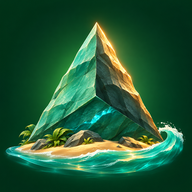

# 三角岩大冒险 · The Triangle Frontier

第一人称海岛生存与创造游戏。浏览器运行，包含三角岩采集、合成建造、房屋、飞行、潜水、农耕、盔甲、骨器与魔法系统。

## 开始游玩

- **在线版**：启用本仓库的 GitHub Pages 后，访问 Pages 页面。
- **离线版**：[下载单文件 HTML](downloads/三角岩大冒险-第一人称.html)，保存到本机，再用支持 WebGL 的浏览器打开。
- 初次进入后按弹窗选择设备，并确认生存或创造模式。模式绑定当前存档，不能在游戏中切换。
- 存档保存在当前浏览器的本地存储中，不上传服务器。本地文件版与在线版属于不同地址，存档彼此独立；更换浏览器或清除网站数据会影响存档。

## 操作

| 操作 | 电脑按键 |
|---|---|
| 移动、转头 | WASD、鼠标 / 方向键 |
| 采集 / 攻击 / 手持物摆放 | 左键 / F |
| 互动 / 开门 | E |
| 跳跃 / 潜水上浮 | 空格 |
| 背包、快捷栏 | B、1—9 |
| 魔法（先建魔法台） | M / 点击底部魔法条 |
| 潜水 / 恢复浮游 | O |
| 水下继续下潜 | Q |
| 创造物品 / 创造飞行 | C / H（仅创造模式） |
| 灵魂勘探 | V |

平板与手机选择触屏设备后使用屏幕摇杆和按钮。设备性能会影响大型 3D 场景的帧率。

## 主要玩法

- 用铲子挖土，遇石层改用镐 / 锤；地下矿层会持续生成。
- 合成台支持手动摆放配方及升级；织布机可纺织、染色并制作旗帜。
- 先建魔法台再施法，击杀获得魔法值。羊牛与安全维度动物平时中立。
- 野生番茄、香果可获得种子，使用锄头开垦，再播种和收获。
- 骷髅掉骨头，可制作骨剑、骨镐、骨铲、骨块与骨甲。盔甲有减伤和耐久。
- 修建机场后驾驶飞机；建造舰船、营地设施，探索多个维度。

## GitHub Pages

进入仓库 **Settings → Pages → Deploy from a branch**，选择 **main / (root)** 并保存。部署完成后用页面显示的地址访问。

网站包含应用图标和 Web App Manifest；支持的浏览器可“安装应用”或“添加到主屏幕”。首次在线访问完成并缓存资源后，可离线再次打开。离线单文件也可直接下载使用。

## 文件

- `index.html` / `game.js` / `style.css`：游戏页面、逻辑、样式。
- `three.module.js`：Three.js r170（MIT）。
- `assets/`：1024、512、192、180、64、32 尺寸的应用图标和 ICO。
- `manifest.webmanifest` / `sw.js`：主屏幕应用与离线缓存。
- `downloads/`：离线单文件版本。
- `ICON_DESIGN.md`：图标设计、生成方式与提示词。

## 第三方说明

Three.js 采用 MIT 许可，完整声明见 [THIRD_PARTY_LICENSES.txt](THIRD_PARTY_LICENSES.txt)。本仓库未为其他游戏代码和素材授予额外开源许可。游戏是独立项目，与 Minecraft / Mojang 无关联。
